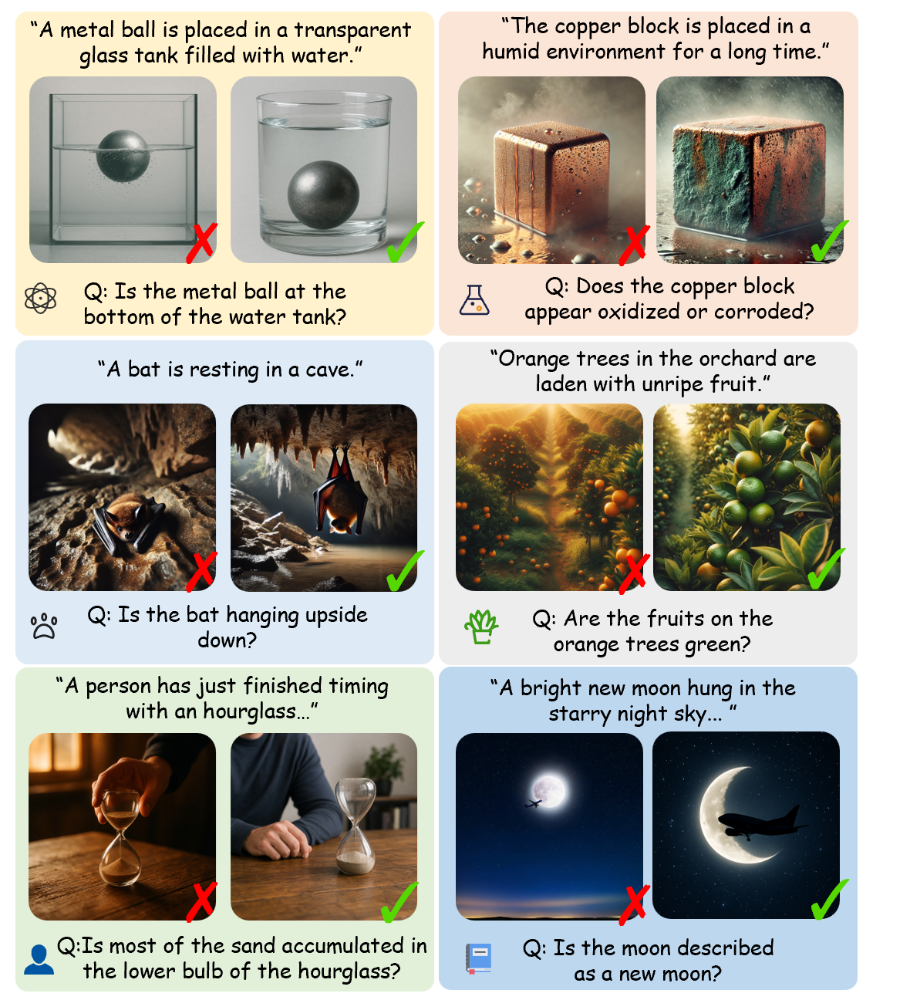

# Align Beyond Prompts: Evaluating World Knowledge Alignment in Text-to-Image Generation

Recent text-to-image (T2I) generation models have advanced significantly, enabling the creation of high-fidelity images from textual prompts. However, existing evaluation benchmarks primarily focus on explicit text-image alignment, neglecting the alignment of generated images with real-world knowledge that extends beyond the provided prompts. To address this gap, we introduce **Align Beyond Prompts (ABP)**, a comprehensive benchmark designed to measure world-knowledge alignment beyond explicit user prompts.

ABP comprises over 20K meticulously crafted prompts covering six distinct scene categories: physical, chemical, animal, plant, human, and factual scenes. We further propose **ABPScore**, an evaluation metric that decomposes alignment into text-image consistency and world-knowledge alignment, and demonstrates strong correlation with human judgments. Through a comprehensive evaluation of ten state-of-the-art T2I models, we find that even top-performing models such as GPT-Image-1 face substantial limitations in generating images that reflect implicit real-world knowledge.

To address this limitation, we train a lightweight **World Knowledge Reasoner (WKR)** that explicitly infers and injects world knowledge into prompts at inference time. WKR lifts the world-knowledge alignment score by 14.3 percentage points on FLUX.1-dev and 18.8 percentage points on Qwen-Image, approaching the performance of GPT-4o-based prompt enrichment.

 

## Main Results

### Overall ABPScore before and after GPT-4o-based prompt enrichment

| **Models** | **Original** | **Enrich** | **Gain** |
| --- | ---: | ---: | ---: |
| SDXL | 0.6338 | 0.7087 | +0.0749 |
| SD3-M | 0.6491 | 0.7625 | +0.1134 |
| SD3.5-L | 0.6736 | 0.7623 | +0.0887 |
| FLUX.1-dev | 0.6472 | 0.7524 | +0.1052 |
| CogView4 | 0.6461 | 0.7589 | +0.1128 |
| Qwen-Image | 0.7157 | 0.8367 | +0.1210 |
| Midjourney | 0.6795 | 0.7633 | +0.0838 |
| Gemini 2.0 | 0.6977 | 0.7904 | +0.0927 |
| DALL-E 3 | 0.7765 | 0.8299 | +0.0534 |
| **GPT-Image-1** | **0.8395** | **0.8784** | **+0.0390** |

### WKR improves world-knowledge alignment beyond the prompt

| **Backbone** | **Original S_beyond** | **WKR** | **GPT-4o Enrich** |
| --- | ---: | ---: | ---: |
| FLUX.1-dev | 0.5098 | 0.6524 | 0.6798 |
| Qwen-Image | 0.5620 | 0.7500 | 0.7700 |

### Correlations between each evaluation metric and human judgment on ABP

| **Method** | **Spearman's ρ (%)** | **Kendall's τ (%)** |
| --- | ---: | ---: |
| CLIPScore | 10.7 | 7.5 |
| SigLIP | 15.5 | 10.9 |
| HPS V2 | 10.2 | 7.1 |
| ImageReward | 15.6 | 10.9 |
| PickScore | 18.4 | 12.9 |
| SCISCORE | 15.8 | 11.1 |
| **ABPScore (Ours)** | **49.7** | **37.0** |

### More details are coming soon...
